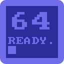
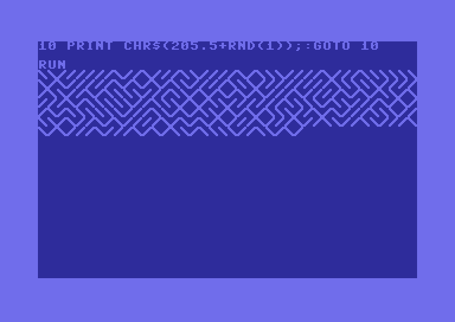
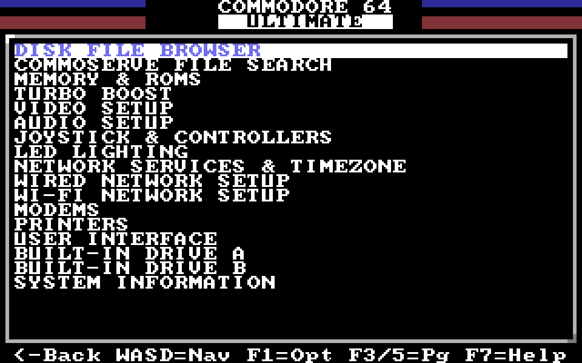
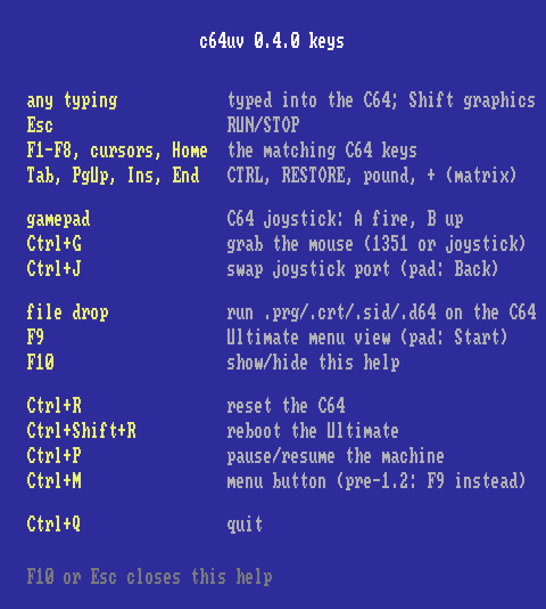

# Commodore 64 Ultimate Viewer



Use your [Commodore 64 Ultimate](https://www.commodore.net/) (or Ultimate 64)
from a Linux or Windows PC over the network: live video and audio streamed
into an SDL window, your keyboard, gamepad and mouse plugged into the C64,
and the Ultimate's menu one keypress away - no second monitor, no capture
card, just the Ethernet cable.

```
./c64uv --host <ultimate-ip>
```

<p align="center">
  
</p>

## What you get

- **Video** - the raw VIC stream (PAL 384×272 @ 50 Hz or NTSC 384×240 @ 60 Hz),
  decoded losslessly and pixel-scaled; latency is roughly one frame on a wired
  LAN. If the stream stops (machine switched off, cable out) the window says
  so and picks the picture up again by itself when it returns.
- **Audio** - the SID output as 48 kHz stereo PCM, with an adaptive latency
  servo that holds the pipeline at ~60 ms.
- **Keyboard** - what you type is typed on the C64: full PETSCII mapping,
  cursor keys, F1–F8, and Esc acting as RUN/STOP. On firmware 1.2.0 or
  newer the keys are pressed on the real keyboard matrix, so games,
  chords and held keys work; older firmware fills the keyboard buffer,
  which is enough for BASIC.
- **Gamepad** - plug in a controller and it is a C64 joystick (firmware
  1.2.0 or newer): d-pad or left stick for directions, A = fire, B = up for
  jumping. The first pad sits in control port 2, a second one in port 1
  for two players; Ctrl+J or the pad's Back button swaps them. Start opens
  the Ultimate menu, where the d-pad, A and B pick a game from the couch.
- **Mouse** - **Ctrl+G** grabs the pointer and the PC mouse is a 1351 mouse
  in control port 1 (firmware 1.2.1 or newer): GEOS with its `COMM 1351`
  input driver, paint programs, anything that reads a real 1351. Ctrl+G
  again gives the pointer back; `--mouse` starts grabbed, `--mouse-speed`
  scales it. On firmware with `machine:input` but no mouse events, or with
  `--mouse-joy`, the mouse steers the joystick lines instead, which is
  what GEOS's default `JOYSTICK` driver reads (see Limitations).
- **Ultimate menu** - press **F9** and the window shows the Ultimate's own
  menu (file browser, disk mounting, configuration), driven from your
  keyboard; F9 again returns to the C64. On firmware 1.2.0 or newer it is
  the machine's real menu, read over the REST API, so it also works over
  WiFi; older firmware shows the telnet remote menu instead.
- **Discovery** - run it with no address and it finds the Ultimate on your
  LAN (preferring its wired interface, the one that can stream).
- **Run files** - drop a `.prg`, `.crt`, `.sid` or `.d64` onto the window
  (or `--run file`) and the machine runs it, cartridge-safe; `--store`
  keeps dropped disk images on the Ultimate.
- **Machine control** - reset, reboot, pause/resume, and menu button as
  hotkeys or one-shot `--do` commands; F10 shows the in-window key
  reference.
- **Shareable streams** - `--multicast` lets any number of viewers watch
  the same machine.

<p align="center">
  
  
</p>
<p align="center"><sub>F9 shows the Ultimate's own menu; F10 the key reference.</sub></p>

## Requirements

- Linux or Windows, x86_64 (prebuilt on the [releases
  page](https://github.com/crustovsky/C64UV/releases): static Linux binary,
  Arch package, Windows zip). Building from source needs SDL3, libcurl, a C
  compiler and `make` (`pacman -S sdl3 curl` / `apt install libsdl3-dev
  libcurl4-openssl-dev`; Windows builds are cross-compiled with MinGW, see
  the release workflow).
- A C64 Ultimate / Ultimate 64 on your network. The viewer talks to its REST
  API (HTTP), streaming ports (UDP 11000/11001), DMA socket (TCP 64), and,
  on firmware before 1.2.0, its telnet menu (TCP 23).

### On the Ultimate, enable (menu → Network Services & Timezone)

| Service | Needed for |
|---|---|
| Web Remote Control Service (REST API, port 80) | discovery, starting/stopping the streams, the Ctrl+R/P/M machine controls and `--do`, running dropped `.prg`/`.crt`/`.sid` files, mounting `.g64`/`.d71`/`.g71`/`.d81` images, mounting stored images by path (`--store`), cartridge parking, and on firmware 1.2.0 or newer matrix-level typing, the gamepad, the mouse and the F9 menu view |
| Ultimate DMA Service (port 64) | typing into the C64 (KERNAL buffer), RUN/STOP, and mount-and-run of a dropped `.d64` |
| Telnet Remote Menu Service (port 23) | the F9 menu view on firmware older than 1.2.0 |
| FTP File Service (port 21) | uploading dropped images with `--store` |

Everything else the viewer does needs no service: the video/audio streams
arrive on UDP 11000/11001 once started. The REST API alone gets you a
picture and sound, and on firmware 1.2.0 or newer everything else too;
before that add the DMA service to type, and telnet to browse the
Ultimate's menu from the viewer.

**A firmware update switches every network service off.** The machine
then still answers on the network but refuses the connections; the viewer
tells you which service is off (in the window, in its log, and in
`--discover` when it sees the machine's wired interface) instead of a bare
"no Ultimate found". Switch them back on in the machine's menu under
Network Services & Timezone (Network Settings on older firmware).

### Wired Ethernet is required for the streams

The video/audio streams are generated by the FPGA and **only leave through the
Ultimate's Ethernet port**. With the machine on WiFi alone, stream start fails
with `"No Operational Network Interface"`. Keyboard, menu, and REST work over
either; plug in a cable for the full experience. (Your PC may be on WiFi,
though wired is smoother - the streams total ~22 Mbit/s.)

## Building and running

```sh
make
./c64uv --host 192.168.1.64        # or: export C64U_HOST=192.168.1.64
./c64uv                            # no address? it scans your LAN for one
```

With no `--host` (and no `C64U_HOST`) the viewer sweeps your local /24
subnets with one `/v1/info` request per address and uses the Ultimate it
finds; `--discover` runs the same scan, lists every Ultimate on the
network, and exits.

The viewer asks the Ultimate to send its streams to your PC's address on the
Ultimate's subnet (auto-detected, wired interfaces preferred; override with
`--dest`). It re-issues the start request every 5 s, so streams survive
machine resets - and it pings the Ultimate first, because the firmware
refuses to start a stream toward an address missing from its ARP table.

| Key | Action |
|---|---|
| any typing | typed into the C64 (lowercase = letters, Shift = PETSCII graphics) |
| Esc | RUN/STOP |
| F1–F8, cursors, Home, Del/Ins | the corresponding C64 keys |
| gamepad | C64 joystick on port 2: d-pad / left stick, A = fire, B = up, X / Y = second and third fire button; a second pad is the joystick in port 1 (needs firmware 1.2.0+) |
| Ctrl+G | grab / release the mouse: a 1351 mouse in port 1 (firmware 1.2.1+), otherwise it steers the joystick |
| Ctrl+J, pad Back button | swap the control ports of the joysticks |
| **F9**, pad Start button | toggle the Ultimate menu view (in it the pad's d-pad, A and B work as cursor keys, RETURN and back) |
| **F10** | in-window key reference (same table as `--help`) |
| Ctrl+R / Ctrl+Shift+R | reset / reboot the machine |
| Ctrl+P | pause / resume the machine |
| Ctrl+M | press the Ultimate's menu button; on firmware 1.2.0+ the window shows the menu it opens, like F9 (older firmware: the on-screen menu answers the physical keyboard only, use F9) |
| Ctrl+Q | quit |

**Drop a `.prg`, `.crt`, `.sid`, or `.d64` file onto the window** and the
Ultimate runs it (DMA program run, cartridge run, SID player, or for a
`.d64`: mount on drive A, reset, `LOAD"*",8,1` and `RUN`, all done by the
firmware over the DMA socket). If a cartridge is configured on the machine,
it is parked for the run and restored afterwards, so a freezer cart won't
hijack the program's reset; the cart is back on your next manual reset. The
same works headless: `c64uv --run game.prg`.

The window title shows the transfer progress ("sending game.d64 42%").
The Ultimate serves one DMA-socket client at a time, so the viewer drops its
keyboard connection for the duration and reconnects it on your next keypress;
a second drop while one is in flight is refused.

Other disk images (`.g64`, `.d71`, `.g71`, `.d81`) are mounted on drive A
without touching the machine; type `LOAD"*",8,1` yourself. Every image is
copied to the Ultimate's temp area first, so writes never reach the file you
dropped, and the temp area is a RAM disk that is gone at power-off.

To keep dropped images, start the viewer with `--store FOLDER` (or set
`C64U_STORE`), e.g. `--store /Temp` or `--store /Usb0/games`. A dropped
image is then uploaded into that folder over FTP (the Ultimate's FTP service
is on by default), mounted from there read-write, and autostarted by the
viewer: it resets the machine and types `LOAD"*",8,1` and `RUN` once the
READY prompt is back, for every image type. Dropping a file of the same
name replaces the stored copy. `.prg`/`.crt`/`.sid` drops are unaffected
by `--store`.

The same machine controls work headless: `c64uv --do reset` (also `reboot`,
`pause`, `resume`, `menu`, `poweroff`) issues one REST call and exits.
Every viewer action has a one-shot flag, so scripts and agents can drive the
machine without a window: `--discover`, `--do`, `--run` (with `--store`),
`--type 'LOAD"*",8,1\n'` (types into the C64, `\n` = RETURN),
`--screen` (prints the 40x25 text screen read from screen RAM, the way to
check what a typed command did), `--joy 2:left,fire` (taps joystick inputs
on a control port), `--keys "f1,left_shift+a,space:500"` (presses keys on
the keyboard matrix by name, chords with `+`, hold time in ms after `:`, so
a script can press keys in a game; `--type TEXT --matrix` types text the
same way), `--mouse-send "move:40:-10 left"` (1351 mouse motion, clicks and
wheel), `--menu-screen` (the open Ultimate menu as text, the selected row
marked `>`; open it with `--do menu` and drive it with `--keys`),
`--dump frame.ppm` (one video frame) and `--term-test` (the telnet menu as
text). `--joy`, `--keys`, `--matrix` and `--menu-screen` need firmware
1.2.0 or newer, `--mouse-send` 1.2.1. After `--do reset` give the C64
about three seconds to boot before typing. Exit status is 0 on success, 1
when the Ultimate refused or did not answer, 2 for a usage error. If
your Ultimate has a network password set (firmware 3.12+), pass it with
`--password` or the `C64U_PASSWORD` environment variable; it is sent as the
`X-Password` header on every request, discovery included.

### Several viewers, one Ultimate

The Ultimate streams to a single destination, so normally the first viewer
wins. `--multicast` asks it to stream to multicast groups instead
(239.0.1.64 video, 239.0.1.65 audio): every viewer started with
`--multicast` joins the groups and shows the same machine, and c64uv can
share the stream with other multicast-aware tools watching the same groups.
A custom group works too: `--dest 239.x.y.z` joins that group for video and
group + 1 for audio. When one multicast viewer quits it stops the stream,
and the remaining viewers' keepalive restarts it within 5 s (a short blip).

On firmware 1.2.0 or newer the menu view follows the machine: launch
something from it (Run Disk, Run Program) or leave the menu with RUN/STOP
and the window is back on the C64 screen. The telnet menu of older firmware
is its own remote session: after you launch something from it the menu
stays where it was, so press F9 to flip back to the C64 screen and watch
it boot.

Useful flags: `--no-audio`, `--no-keyb`, `--scale N` (window size),
`--discover` (list Ultimates on the network and exit), `--verbose`
(fps/packet/latency stats), `--dump f.ppm` (grab one frame headless),
`--term-test` (print the telnet menu screen as text and exit), `--no-start` (listen
only; pair with `tools/mockstream.py` to develop with no hardware).

### Installing

Every release ships three builds; pick one from the [latest
release](https://github.com/crustovsky/C64UV/releases/latest):

- **Arch Linux**: `c64uv-<version>-1-x86_64.pkg.tar.zst`, installed with
  `sudo pacman -U <file>` (removed with `pacman -R c64uv`). Comes with the
  desktop entry and icon.
- **Other Linux**: `c64uv-<version>-linux-x86_64.tar.gz`, a static binary;
  unpack it anywhere.
- **Windows**: `c64uv-<version>-windows-x86_64.zip`; unzip and run
  `c64uv.exe` from a terminal, keeping `SDL3.dll` next to it. Everything
  in this README applies. A VPN claiming the LAN route may need to be off
  (the Linux build pins the stream's ARP prime to the LAN interface;
  Windows sends a plain ping).

From source: `make`, then `make install` (respects `DESTDIR` and `PREFIX`,
default `/usr`) installs the binary, desktop entry and icon; `makepkg -si`
in `packaging/aur` builds the Arch package locally (e.g. on aarch64). Set
`C64U_HOST` in your environment if you launch it from the desktop menu
rather than a terminal.

## Limitations

- On firmware older than 1.2.0, typed input goes through the KERNAL keyboard
  buffer: it works for BASIC, the READY prompt, and anything reading input
  normally - **not** for games that scan the keyboard matrix directly, and
  there is no joystick. The viewer probes for the hardware-level
  `machine:input` API (firmware 1.2.0 and newer) on every start and
  switches to true matrix-level press/release automatically when the
  machine has it; games, chords, held keys and the gamepad then work, with
  Tab acting as the C64 CTRL key, PageUp as RESTORE, Insert as £ and End as
  + (both also on the numeric keypad; a PC has no unshifted key for
  either).
- The gamepad only works while the viewer window has focus (click it
  first). To play with another window in front, start the viewer with
  `SDL_JOYSTICK_ALLOW_BACKGROUND_EVENTS=1` in the environment.
- Port numbers are the C64's own: "port 2" is the port a game reading
  joystick 2 sees. The viewer reads the Ultimate's "Joystick Swapper"
  setting once at start and converts; change that setting on the machine
  and the viewer needs a restart to follow.
- The mouse is a 1351 in control port 1, and its left button is that
  port's fire line, shared with a gamepad sitting there. The pointer's
  speed follows the Ultimate's Mouse Sensitivity setting (`--mouse-speed`
  scales on top). Fast flicks are capped: the firmware sends one mouse
  report every 20 ms, so the viewer drops motion it could only deliver
  late.
- In joystick mode (firmware without mouse events, or `--mouse-joy`) the
  mouse is a joystick, not a 1351. A direction is held while the mouse
  moves and released `--mouse-hold` ms after it stops (default 50), so the
  pointer travels at GEOS's joystick rate, a short flick still moves it
  further than the mouse did, and precise positioning takes small nudges.
  The first grab in this mode moves the joystick to port 1, where GEOS's
  built-in `JOYSTICK` driver reads it; Ctrl+J swaps. The speed is GEOS's
  own mouse-speed setting. It works with joystick-as-pointer software
  only, not with `COMM 1351` or anything reading the SID POT registers.
- The Ultimate's menu overlay is not part of the VIC stream; the F9 view
  is how the viewer shows it. On firmware older than 1.2.0 the on-screen
  menu (Ctrl+M) cannot be driven from the viewer: every remote keystroke
  is a DMA write into C64 memory, and the firmware closes its menu before
  any DMA write, so the first key you press kicks the menu out. That is
  what the telnet view is for there.
- IPv4 only. The device streams to one destination, so it's one viewer per
  Ultimate unless everyone uses `--multicast`.

## How it talks to the machine

REST (`/v1/streams/*`, `/v1/machine:*`) for control; UDP 11000 carries
4-bit VIC color indices (384 px × 4 lines per 780-byte packet), UDP 11001
carries 192 stereo s16le frames per packet; TCP 64 speaks the firmware's
socket-DMA protocol (`KEYB` 0xFF03, `DMAWRITE` 0xFF06); TCP 23 is a VT100
session emulated in `src/term.c`. On firmware 1.2.0 or newer keys, joysticks
and the mouse go through `POST /v1/machine:input`, and the menu view reads
`GET /v1/machine:menu_screen`. Protocol docs:
[REST API](https://1541u-documentation.readthedocs.io/en/latest/api/api_calls.html),
[data streams](https://1541u-documentation.readthedocs.io/en/latest/data_streams.html).

## License

MIT for this project's code. `src/font8x8.h` is public domain (Daniel
Hepper / Marcel Sondaar).
